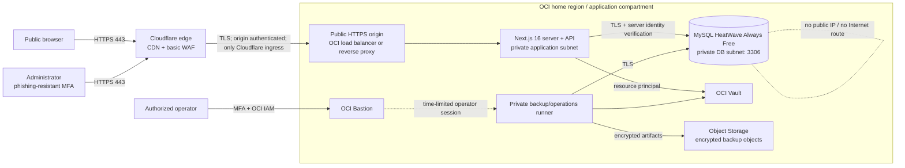

# Network topology

Status: proposed design; no resources, DNS, or firewall rules have been created.

## Selected topology

The confidential-data path keeps the Next.js server/API runtime and MySQL in the same OCI VCN. Cloudflare terminates public edge traffic and proxies HTTPS to an OCI application origin. MySQL has only a private endpoint. Public pages may later be separated to static hosting, but no Vercel function may connect directly to MySQL.

## Trust boundaries and rules

1. **Internet to Cloudflare:** HTTPS only; HSTS after domain validation; rate limiting is defense-in-depth, not the primary abuse control.
2. **Cloudflare to origin:** HTTPS with certificate validation. Restrict origin ingress to Cloudflare-published IP ranges where the selected origin supports it, add origin authentication, and monitor rejected direct-origin attempts. Do not expose the origin hostname in public content.
3. **Origin to application:** only the reverse proxy/load balancer may reach the application port. Health endpoints reveal no version, secret, or dependency status.
4. **Application to database:** NSG permits TCP 3306 only from the application and backup-runner NSGs. No `0.0.0.0/0`, public IP, NAT ingress, or Cloudflare-to-DB path.
5. **Application egress:** allow DNS, OCI Vault/Object Storage service gateways, time synchronization, and explicitly approved identity/telemetry endpoints. Deny arbitrary Internet egress where operationally possible.
6. **Operations:** OCI Bastion provides time-limited access. No persistent public SSH/RDP. Production SQL access uses named IAM identities, approval, and session logging.
7. **Backups:** backup runner has read/backup privileges but cannot alter application tables; Object Storage write access is scoped to the backup bucket and prefix.

## Why direct Vercel-to-MySQL is rejected

Vercel documents that Functions use dynamic outbound IP addresses by default, so an origin cannot safely allowlist them. Static IPs require Pro or Enterprise, and Secure Compute is an Enterprise add-on; its documented private peering is not an OCI connectivity guarantee. Edge/Routing Middleware is also outside those static-egress features. A public MySQL endpoint would violate this design regardless of TLS.

For zero-investment work, the data-handling Next.js runtime therefore belongs on OCI Always Free Compute inside the VCN, subject to capacity. If the public site remains on Vercel, it may serve public/static content only and call a separately protected OCI HTTPS API; it must never receive a database credential. Before choosing that split, prototype CORS, CSRF, origin authentication, rate limits, and failure behavior with synthetic data.

## Required Step 2B network tests

- Prove the DB endpoint has no public route and that port 3306 is unreachable externally.
- Prove only the application and backup NSGs can connect.
- Prove the MySQL client fails on missing/invalid CA, hostname mismatch, or non-TLS transport.
- Attempt direct-origin requests and verify rejection.
- Confirm administrative access expires and produces audit records.
- Confirm denied egress cannot silently fall back to an unrestricted route.

## Sources verified 2026-11-03

- [Oracle MySQL networking](https://docs.oracle.com/en-us/iaas/mysql-database/doc/overview-networking.html)
- [Oracle mandatory policies and NSG permissions](https://docs.oracle.com/en-us/iaas/mysql-database/doc/mandatory-policies-and-permissions.html)
- [Vercel: allowlisting deployment IP addresses](https://vercel.com/kb/guide/how-to-allowlist-deployment-ip-address)
- [Vercel Functions](https://vercel.com/docs/functions)
