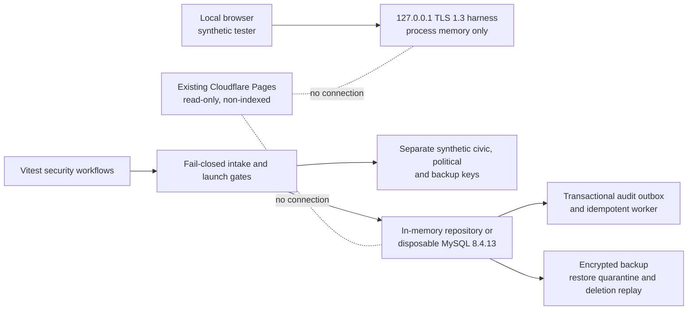

# Step 5E staging architecture

Date: 5 November 2026

## Deployed state

Only the existing static Cloudflare Pages preview is deployed. It has no collection transport, API, database, AI provider or browser response storage. Step 5E remains local and synthetic.

## Local trust boundaries

1. The browser interface binds to `127.0.0.1`, requires TLS 1.3, same-origin Fetch Metadata and a Secure/HttpOnly/SameSite CSRF cookie plus header proof.
2. The application runtime accepts only the synthetic configuration and refuses production approval evidence.
3. Keys and secrets live in memory and are destroyed on runtime teardown. They are not substitutes for KMS or a secret manager.
4. The durable adapter is used only with a disposable loopback MySQL 8.4.13 server. No public listener or production connection is configured.
5. Audit records contain classifications and opaque response identifiers, never answers, consent bodies, cookies, receipt codes or network identifiers.
6. Restore output remains quarantined. Even a clean restore cannot be released automatically.

## Future production binding — design only

A future funded service must use an India-region private runtime, TLS-authenticated private MySQL 8.4, short-lived workload identity, managed secrets, separated non-exportable KMS authorization domains, a durable transactional outbox, encrypted PITR/backups, quarantine restore, deletion-ledger replay, MFA and two-person administrator approval. The application validator rejects a public database hostname, inline secrets, shared key domains, missing recovery evidence or static workload keys.

This design is not permission to provision infrastructure. With ₹0 available, there is no approved production binding.
