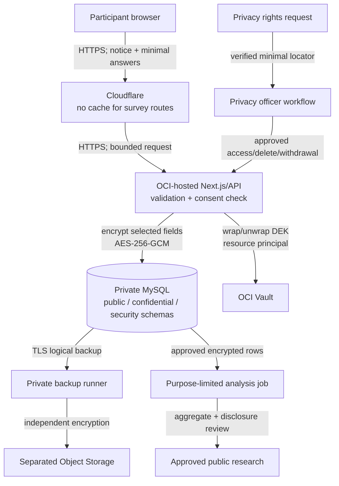

# Privacy, classification, and data flow

Status: proposed privacy architecture; not legal advice. No survey or personal-data collection is enabled.

## Governing principles

- Define a specific research purpose before each survey and collect only fields necessary for it.
- Anonymous by default. Optional contact/identity is separate, separately encrypted, and shorter-lived.
- Political opinions and identity-response linkage are internally classified as highly restricted regardless of whether a law uses that label.
- Consent must be specific, informed, affirmative, versioned, accessible in English/Punjabi/Hindi, and as easy to withdraw as to grant where consent is the basis.
- Never imply that machine translations are legally verified. Human legal/linguistic review is required for notices and consent.
- No advertising trackers, session replay, fingerprinting, or third-party analytics on survey/admin routes.
- Aggregation and minimum-cell rules precede publication. “De-identified” is a claim that requires testing against linkage risk.

## Proposed data flow

Cloudflare sees transport metadata and, because it terminates edge TLS, may technically process HTTP content. Contract/configuration review and strict no-cache/log-minimization are required. MySQL sees ciphertext for selected fields plus unavoidable structural metadata. Vault sees key-operation metadata, not response plaintext. Analysts should receive purpose-limited aggregate/de-identified datasets, not identity-linked raw tables.

## Data inventory

| Data                                    | Need                                  | Classification               | Location                        | Proposed retention                                                     |
| --------------------------------------- | ------------------------------------- | ---------------------------- | ------------------------------- | ---------------------------------------------------------------------- |
| Published constituency/research content | civic research                        | Public                       | public schema/CDN               | version history while relevant                                         |
| Draft research/correction notes         | editorial workflow                    | Internal/restricted          | public schema workflow tables   | project schedule; review annually                                      |
| Survey definition and notice version    | prove what was asked/consented        | Public/internal              | public schema                   | survey life plus compliance period                                     |
| Answer content                          | research purpose                      | Restricted/highly restricted | confidential ciphertext         | shortest approved analysis period; candidate 12 months                 |
| Optional identity/contact               | follow-up only when separately chosen | Highly restricted            | separate identity ciphertext    | candidate 30–90 days, then erase                                       |
| Consent event/purpose/evidence digest   | demonstrate participant choice        | Restricted                   | confidential schema             | approved compliance period; minimize after answer deletion             |
| Admin IdP subject/roles                 | authorization                         | Restricted                   | security schema/IdP             | active service plus short audit need                                   |
| Audit metadata                          | security/accountability               | Restricted                   | security schema + external copy | candidate 12 months; longer only if justified                          |
| Raw IP/user-agent/fingerprint           | generally unnecessary                 | Do not collect by default    | transient edge/app only         | discard/redact immediately; short incident exception requires approval |
| Backup                                  | recovery                              | inherits highest class       | encrypted Object Storage        | tiered schedule in backup plan                                         |

Retention values are proposals, not approved policy. Legal/privacy owners must set exact periods and document the purpose, start event, deletion method, backup effect, and exceptions.

## Consent and optional political opinions

- A survey version references the exact privacy-notice version and purpose list.
- Show purpose, controller/fiduciary identity, data items, optionality, retention, recipients/processors, withdrawal/rights route, and risk in clear localized language.
- Record grant/withdrawal as immutable events with purpose-specific choices and evidence digest; never infer consent from continued browsing or a preselected box.
- Ask political-opinion questions only after a documented necessity/proportionality assessment, legal basis review, and explicit product approval. Make non-essential questions optional.
- Do not combine responses with electoral rolls, sponsorship, merchandise, contact lists, ad audiences, or constituency inference unless a new purpose and approval explicitly permit it.
- Withdrawal stops future optional processing and initiates the approved deletion/de-linking workflow; immutable minimal compliance evidence may remain only when legally justified.

## Data-subject/participant rights workflow

1. Accept a request through a non-public case channel without asking the requester to reveal survey answers.
2. Collect the minimum locator and verify identity proportionately; anonymous responses may be impossible to locate by design, which the notice must explain.
3. Privacy officer validates scope/deadline and records an opaque case ID.
4. A purpose-built job accesses only necessary identity/response records. No ad hoc SQL export.
5. Provide, correct, restrict, withdraw, or delete as legally applicable. Record completion without copying data into the ticket.
6. Add deletion markers to the protected restore ledger so old backups cannot silently resurrect data.

## Publication privacy

- Analyze without identity fields and with a purpose-specific dataset.
- Enforce minimum cohort/cell sizes; combine/suppress small groups and rare attribute combinations.
- Review free-text answers for names, phone numbers, addresses, political-worker identity, threats, and other accidental disclosure before any quotation.
- Obtain separate quotation permission where required; paraphrase or exclude when re-identification risk remains.
- Document transformations, exclusions, weighting, uncertainty, and correction process. Never publish individual voting intention or infer it from location.

## Processor and cross-border questions

Before launch, document the roles and terms for Oracle, Cloudflare, the identity provider, email/support services, GitHub/Vercel if used, and any monitoring provider. Confirm OCI home region, edge/log locations, sub-processors, deletion/return commitments, breach notification, lawful transfer mechanism, and government-access terms with counsel. If those answers are incomplete, do not collect highly restricted data.

## Privacy launch gates

- Approved data inventory, purpose, legal basis, notices, translations, retention, and rights process.
- Data-protection impact/risk assessment for political opinions and identity linkage.
- No trackers and verified edge/application/DB log redaction.
- Anonymous path works without optional identity.
- Consent versioning and withdrawal/deletion tested end to end with synthetic data and backups.
- Disclosure-control review passes for aggregate reports.
- Incident contacts and notification decision process exist without inventing public contact details.
